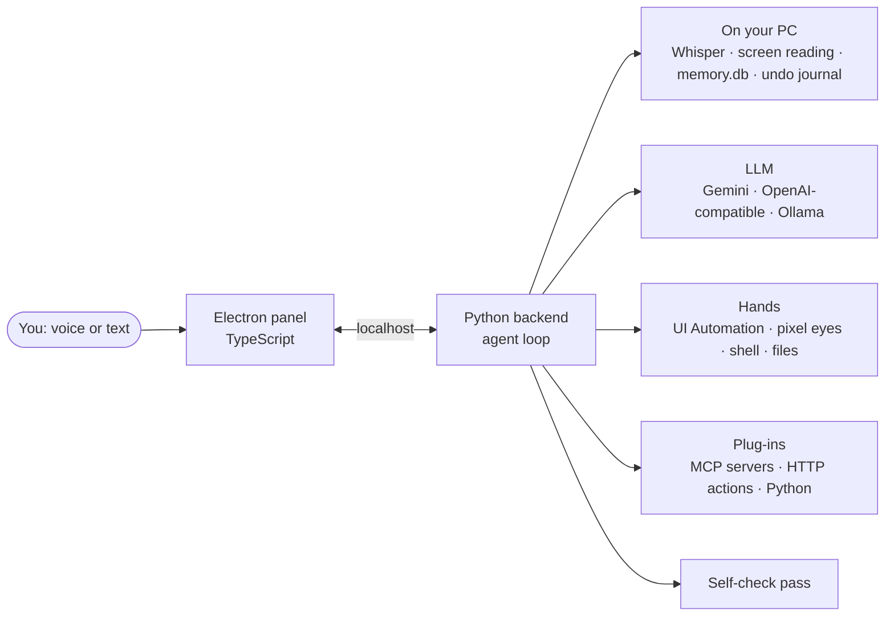

<div align="center">

# Jarvis
NOT PRODUCTION READY, SOON
**A voice first AI agent that uses your Windows PC the way you do.**<br>
If you can do it with a mouse, a keyboard or a command line, Jarvis can too.

[](https://github.com/muneeb12011/jarvis-desktop-agent/releases/latest)


[**Download**](https://github.com/muneeb12011/jarvis-desktop-agent/releases/latest) ·
[What it does](#what-it-does) ·
[Install](#install) ·
[Integrations](#plug-anything-in) ·
[Roadmap](ROADMAP.md)

<!-- Add a screenshot or GIF of the panel here: docs/panel.png -->

</div>

---

## Why this exists

Most assistants answer questions. Jarvis finishes the job.

Say *"Jarvis, find the PDFs I downloaded this week and open the newest"* and it
searches the folder, opens the file and tells you which one it picked. Say
*"research the companies hiring React devs in Lahore and make me a list"* and it
goes off to do that in the background while you keep working.

Three ideas shape everything in it:

1. **It acts, then checks.** After changing something, a second skeptical pass
   looks at what actually happened. If the click missed, Jarvis retries once,
   then tells you plainly instead of saying "Done!".
2. **Everything it does can be taken back.** Before changing a file, setting,
   reminder or window layout it saves what was there. "Undo that" works.
3. **Your PC stays yours.** Speech recognition, screen reading, meeting
   transcripts and your activity history all stay on your machine. The AI
   model only sees what a request needs, and you can run the model itself
   locally too: Jarvis works with **Ollama**, so nothing has to leave your PC.

---

## What it does

### Controls the whole PC
Opens apps, clicks, types, manages windows and files, runs PowerShell, controls
media, volume, brightness, power and the clipboard. It reads each app's real
buttons through Windows UI Automation. In apps that don't expose any (games,
canvas tools, remote desktops), **pixel eyes** numbers the text and icons it
finds on screen, so it clicks "Export" by position instead of guessing.

### Works the web
Through a built-in Playwright integration it drives websites by their
structure: fills forms, follows links, reads pages. That is far more reliable
than clicking pixels, and it means anything you do in a browser (research,
outreach, posting, data entry) is something Jarvis can do for you. Risky actions
ask first, and you should read anything before it goes out under your name.

### Works while you work
Hand it anything long and it runs as a **background job**: up to three at once,
each with a live step and a cancel button. Jobs never touch your mouse or
keyboard, so they never fight with you.

### Runs on its own
**Routines** are automations written in plain English:

| Trigger | You say |
|---|---|
| Time | "Every weekday at 9, brief me and open my standup notes." |
| Interval | "Every hour, remind me to stretch." |
| An app opens | "When I open VS Code, play my focus playlist and set volume to 25." |
| A file lands | "Whenever a PDF lands in Downloads, tell me what it is." |
| A page changes | "Check the PS5 page every 30 minutes and tell me when it says in stock." |
| Startup | "When Jarvis starts, tell me today's reminders." |
| A name | "Make a routine called wrap up that saves my workspace and summarises my day." |

### Knows your work
It keeps a private **activity timeline** (which app and window you were in, idle
time skipped, deleted after 30 days) so you can ask *"how long was I in VS Code
today?"* or *"find that video I watched on Monday."* It also keeps profiles of
the **people and projects** in your life, including promises in both directions:
*"I promised Ali the API docs by 5pm"* sets the reminder, and *"who's waiting on
me?"* lists what you owe.

### Notices before you ask
**Heads-up** (off until you enable it) watches developer apps for text only,
never screenshots. When an error appears in a terminal or editor, a card
explains it in one sentence with a **Help me fix** button. It also catches
finished downloads and frozen apps. Each error is offered once, with a
one-minute cooldown, and it stays quiet while Jarvis is working.

### Takes meeting notes
*"Take notes on this call."* Jarvis transcribes your mic as **You** and what the
PC plays as **Them**, locally with Whisper. *"Stop the meeting"* writes a
summary, decisions and action items, and one click turns your items into
reminders and other people's into things owed to you. Audio is never saved.
Tell people they're being transcribed.

### Fixes text anywhere
Select text in any app, press **Ctrl+Alt+Space**, and choose: explain,
summarise, fix, rewrite, shorten, make casual, translate (English ⇄ Urdu), draft
a reply, or type your own instruction. **Replace selection** pastes the result
back over the original and restores your clipboard.

### Learns from you
Teach it by talking to it. *"Remember I prefer VS Code over everything else."*
*"Call me boss."* A routine, a workspace, a profile for someone you work with:
each one is saved and used from then on, so you explain less every week and it
does more of the work your way. The more you teach it, the better it fits you.

It learns by building a memory of you on your own PC, not by retraining the AI
model. You stay in control: *"what do you know about me?"* shows it, and
*"forget that"* removes it.

### Remembers workspaces
Arrange your windows, say *"save this as my coding workspace."* Later *"set up
coding"* relaunches what's closed and puts every window back where it was.

---

## Trust model

An agent that can use your computer needs honest limits. Here are Jarvis's.

| | |
|---|---|
| **Asks first** | Closing apps, overwriting files, shell commands that change things, shutdown, and anything an integration marks destructive. An **Allow / Don't** card appears; ignore it for 60 s and nothing happens. |
| **Stops instantly** | **Ctrl+Alt+X**, **Esc**, the Stop button, or slamming the mouse into a screen corner. |
| **Undoes** | File writes (old version restored; files Jarvis created go to `backend\undo\trash`, never deleted), settings, reminders and timers, notes, remembered facts, routines, workspaces, window layouts, clipboard, volume. Backups are kept 7 days. |
| **Admits what it can't undo** | Shell commands, typing and integration calls. It says so instead of pretending. |
| **Stays local** | Whisper speech recognition, screen reading, meeting transcripts and the activity timeline. |
| **Shares with the model** | Only what a request needs. Heads-up sends just the last lines of an error. |

Ask *"what did you change today?"* to see the full journal.

---

## Install

### For users

1. Download `Jarvis-Setup-<version>.exe` from the
   [latest release](https://github.com/muneeb12011/jarvis-desktop-agent/releases/latest).
2. Run it. Windows may say **"Windows protected your PC"** because the installer
   isn't code-signed yet. Click **More info → Run anyway**.
3. First launch downloads a private Python and Jarvis's packages (about
   600 MB, a few minutes). Nothing touches your existing Python.
4. The setup wizard asks for your name, a free
   [Gemini API key](https://aistudio.google.com), a mic test, a voice and
   privacy choices.

**Needs:** Windows 10/11 (64-bit), about 3 GB free disk space, internet on first
launch. Your data lives in `%APPDATA%\Jarvis`, so updates never touch it.

If something fails, the log is `%APPDATA%\Jarvis\logs\install.log`, and
`check-jarvis.cmd` tests screen reading, audio devices, the speech model and
your key.

### From source

```powershell
git clone https://github.com/muneeb12011/jarvis-desktop-agent.git
cd jarvis-desktop-agent
setup-jarvis.bat      # once: installs everything, details in setup.log
start-jarvis.bat      # starts Jarvis; also works as a restart
```

To build your own installer: `build-installer.cmd` produces
`frontend\release\Jarvis-Setup-<version>.exe`.

---

## Talk to it

| How | What happens |
|---|---|
| Say **"Jarvis, …"** | Wake word. Works any time, panel hidden or not. |
| Say **"Jarvis"**, wait for the chime | Same, in two steps. |
| **Ctrl+Alt+J** | Opens the panel and listens straight away. |
| Type in the box | Text in; text (and voice, if the speaker icon is on) out. **↑** brings back your last message. |
| After a spoken answer | It keeps listening about 6 s for a follow-up. No wake word needed. |
| Talk over it | Say "stop" or "Jarvis, …" to cut it off mid-sentence. |
| **Ctrl+Alt+Space** | Text actions on the selected text. |

### Things worth trying

- *"Brief me"*: time, weather, reminders, headlines
- *"What's eating my RAM?"* / *"How's my battery?"*
- *"Open Spotify and play something chill"* / *"Volume 30"*
- *"Open Notepad and draft a message to the team about tomorrow's standup"*
- *"Summarise this page"* / *"What's on my screen?"*
- *"In the background, go through my Downloads and tell me what's safe to delete."*
- *"Remember I prefer VS Code over everything else"* / *"Forget that I like tea"*
- *"Start with Windows"* / *"Speak a bit faster"* / *"Call me boss"*

---

## How it fits together



- **Dynamic toolsets.** To keep requests small and fast, Jarvis sends the model
  only the tools a request needs: a core set, plus groups (files, windows,
  routines, activity, workspaces, each integration) switched on by keywords or
  when the model asks for them.
- **Model rotation.** The free Gemini tier has a *daily* cap per model, so
  Jarvis discovers every Flash model your key can use, rotates when one runs
  out, and remembers which answered last.
- **Everything is logged.** Every action lands in `backend/agent_log.db`.

---

## Plug anything in

Three ways, none of which touch Jarvis's core code. After a change, use
**Settings → Integrations → Reload** or say *"Jarvis, reload integrations."*
Secrets never go in the JSON: write `${NAME}` there and put `NAME=...` in
`backend/.env`.

### 1. MCP servers
[Model Context Protocol](https://modelcontextprotocol.io) is the standard AI
connector format. GitHub, Notion, Slack, Google Drive, Home Assistant, Postgres
and hundreds more ship one. Add it to `backend/integrations.json`:

```jsonc
"mcp_servers": {
  "github": {
    "enabled": true,
    "url": "https://api.githubcopilot.com/mcp/",
    "headers": { "Authorization": "Bearer ${GITHUB_TOKEN}" }
  },
  "files": {
    "enabled": true,
    "command": "npx",
    "args": ["-y", "@modelcontextprotocol/server-filesystem", "C:\\path\\to\\folder"]
  }
}
```

Options: `confirm` (`"auto"` asks for anything destructive, `"always"`,
`"never"`), `only_tools` to expose a subset, plus `env`, `cwd` and `timeout`.

### 2. HTTP actions
Any API or webhook, described once and called by name:

```jsonc
"http_actions": [{
  "enabled": true,
  "name": "lights",
  "description": "Turn a Home Assistant light on or off.",
  "method": "POST",
  "url": "http://homeassistant.local:8123/api/services/light/{action}",
  "headers": { "Authorization": "Bearer ${HA_TOKEN}" },
  "body": { "entity_id": "{entity_id}" },
  "params": {
    "action": { "type": "string", "enum": ["turn_on", "turn_off"] },
    "entity_id": { "type": "string" }
  },
  "confirm": false
}]
```

`{param}` placeholders are filled in by Jarvis. Use `body_text` for plain-text
APIs. Ready-made examples (phone notifications, n8n, Home Assistant) are in
`integrations.json`, switched off.

### 3. Python plugins
Drop a `.py` file in `backend/plugins/`. Copy `_template.py` to start;
`dictionary.py` is a working example.

```python
from app.tools import tool

@tool("crypto_price", "Current price of a cryptocurrency. Use for 'what's bitcoin at'.",
      {"coin": {"type": "string"}}, ["coin"])
def crypto_price(coin: str) -> str:
    ...
```

### Drive Jarvis from outside

Phone shortcuts, Stream Deck, n8n, scripts and CI can all send it commands:

```powershell
$h = @{ "X-Jarvis-Token" = "<JARVIS_AUTH_TOKEN from backend/.env>" }

# Run a command and get the answer back
Invoke-RestMethod -Method Post http://127.0.0.1:8000/api/command -Headers $h `
  -ContentType "application/json" -Body '{"text": "lock my pc", "wait": true}'

# Make Jarvis announce something
Invoke-RestMethod -Method Post http://127.0.0.1:8000/api/notify -Headers $h `
  -ContentType "application/json" -Body '{"text": "Build finished"}'
```

Or with no code: drop a `.txt` file into `backend/inbox/`. Jarvis runs it as a
command and appends the answer to `backend/inbox/replies.log`. Point a
OneDrive or Dropbox folder at it and you can command your PC from your phone.

---

## Models

Set in `backend/.env`. `LLM_PROVIDERS` is tried in order; a rate-limited
provider is skipped automatically.

- **gemini**: free key from [aistudio.google.com](https://aistudio.google.com).
- **openai**: any OpenAI-compatible API. A good free backup is
  [Groq](https://console.groq.com):
  ```ini
  LLM_PROVIDERS=gemini,openai
  OPENAI_BASE_URL=https://api.groq.com/openai/v1
  OPENAI_API_KEY=gsk_...
  OPENAI_MODEL=<a tool-capable model from console.groq.com/docs/models>
  OPENAI_VISION=false
  ```
- **ollama**: run local models on your own PC. Fully private, no API key, no
  quota. Install [Ollama](https://ollama.com), pull a tool-capable model, and
  add `ollama` to `LLM_PROVIDERS`. Best with a GPU: on a CPU-only machine each
  step can take minutes and the model holds several GB of RAM.

Useful switches: `JARVIS_VERIFY=off` (skip the self-check),
`JARVIS_PIXEL_EYES=always|auto|off`, `JARVIS_WHISPER_MODEL=small` and
`JARVIS_MEETING_LANGUAGE=auto` (for Urdu or mixed-language calls),
`JARVIS_HUD_CAPTURABLE=1` in `frontend/.env` (lets you screenshot the panel).

---

## Honest limits

- **Windows only.** It leans on Windows UI Automation and Windows APIs.
- **Free Gemini runs out.** The free tier has daily quotas. Rotation helps, and
  a Groq key as backup covers the rest.
- **Slower than you at long click-throughs.** Every step is look, decide, act,
  check. It wins on tasks you'd rather not do, not on speed.
- **Not code-signed yet.** Windows SmartScreen will warn on first run.
- **Some things can't be undone**, and Jarvis tells you which.

Where it's heading is in [ROADMAP.md](ROADMAP.md): more reliable clicking in
apps Windows can't read, a meeting copilot, and a one-click installer.

---

## Troubleshooting

| Symptom | Fix |
|---|---|
| "I can't reach my language model" | Check your internet first. Otherwise every Gemini model is out of quota: add a Groq key. |
| Everything is slow or the PC freezes | Ollama is loaded in RAM. Remove `ollama` from `LLM_PROVIDERS`. |
| Panel says Offline | The backend isn't running. Run `start-jarvis.bat` and check `backend/logs/console.log`. |
| Mic does nothing | Windows Settings → Privacy → Microphone → allow desktop apps. The settings sheet shows a live mic meter. |
| Voice sounds robotic | The neural voice needs internet; the OS voice is the offline fallback. |
| An integration shows red | The error is under it in Settings, usually a missing token in `.env`. |
| Two copies fight | Both use port 8000. Close one before starting the other. |

Logs: `backend/logs/jarvis.log` (everything), `console.log` (backend startup),
`hud.log` (panel).

---

## Development

```powershell
cd backend
venv\Scripts\python -m pip install -r requirements-dev.txt
venv\Scripts\python -m pytest
```

82 tests cover providers and Gemini model rotation, the agent loop (approvals,
Stop, dynamic toolsets, self-check retries), undo for every supported change,
background jobs, routine triggers, the activity timeline, tool safety rules,
integrations (a real MCP server over stdio, HTTP actions, plugins), meetings,
heads-up and memory. None of them touch your mouse, keyboard or screen.

Layout: `backend/` is the Python agent, `frontend/` is the Electron panel,
`installer/` bootstraps a clean machine.

---

<div align="center">

Built by [Muneeb](https://github.com/muneeb12011).<br>
Use responsibly, and follow the terms of any site or platform you point it at.

</div>
